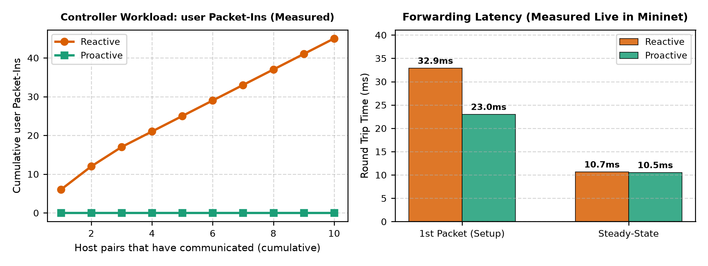
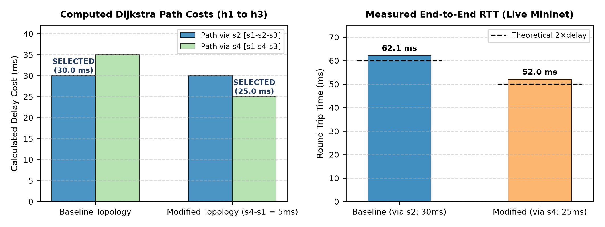
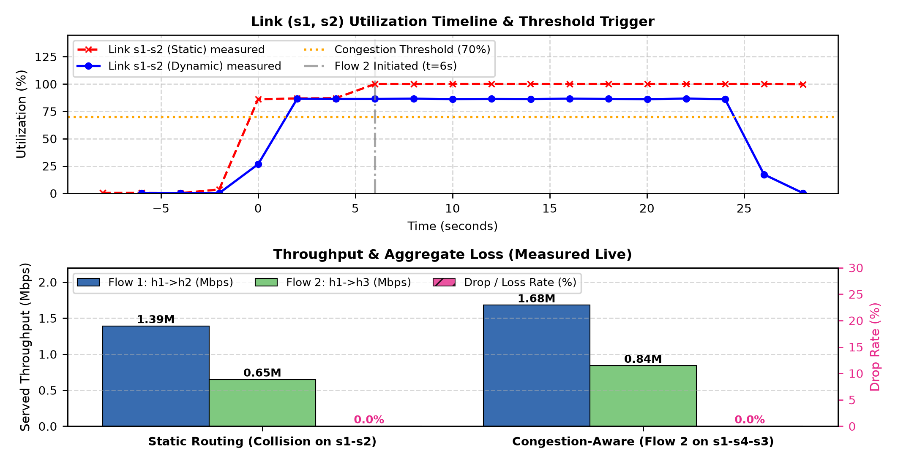

# Software-Defined Networking: Adaptive OpenFlow Routing

An experimental SDN testbed using Python, Ryu, OpenFlow 1.3, Mininet and Open vSwitch. The project compares flow installation strategies, metric-based shortest paths and congestion-aware routing.

## Architecture

Mininet hosts generate traffic through Open vSwitch switches. A centralized Ryu controller installs forwarding rules and, in dynamic mode, monitors port counters to adapt the paths of new flows.

| Experiment | Implementation |
|---|---|
| Reactive and proactive forwarding | `part1_reactive.py`, `part1_proactive.py`, `p1_topo.py` |
| Metric-based routing | `part2_controller.py`, `p3_topo.py`, `p3_topo_mod.py` |
| Congestion-aware routing | `part3_controller.py`, topology JSON configurations |

## Verification

Run the offline algorithmic checks from the repository root:

```bash
python3 run_experiments.py --verify-offline
```

Offline checks use controller stubs when Ryu is unavailable; they do not exercise real OpenFlow I/O.

## Live experiments

Use a Linux testbed with Mininet, Open vSwitch, a compatible Ryu installation, and iperf version 2. Install matplotlib, numpy, reportlab and Pillow for plots and the generated report. Ensure `ryu-manager` is available to the experiment runner.

```bash
sudo python3 run_experiments.py --part 1 --mode reactive
sudo python3 run_experiments.py --part 1 --mode proactive
sudo python3 run_experiments.py --part 2 --topo baseline
sudo python3 run_experiments.py --part 2 --topo modified
sudo python3 run_experiments.py --part 3 --mode static
sudo python3 run_experiments.py --part 3 --mode dynamic
```

Alternatively, `sudo bash run_all.sh` runs all six experiments and regenerates the figures and report. It replaces recorded live results and cleans Mininet state; use a dedicated testbed.

## Results

Recorded flow tables, telemetry, controller logs, measurements and plots are in `results/`. See [technical findings](docs/technical-findings.md).







## Limitations

The controller uses configured topology information. Dynamic routing steers new flows rather than migrating existing flows. Recorded results are testbed-specific; offline checks are not a substitute for live integration tests.
